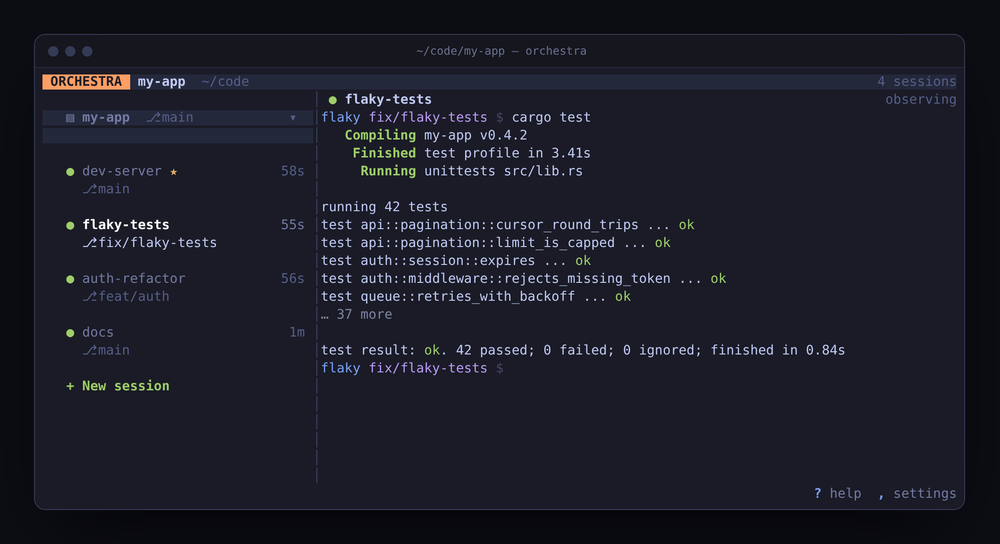

# Orchestra

**Every coding agent. One terminal.**

Orchestra is a terminal session manager for developers who work with coding agents. Claude Code,
Codex, OpenCode, your dev server and your shells run in a background server and show up side by
side, live, one key apart. Built in Rust, driven from the keyboard.

[Website](https://orchestra-landing-seven.vercel.app) · [Releases](https://github.com/humanunsupervised/orchestra/releases) · [npm](https://www.npmjs.com/package/@humanu/orchestra) · [Issues](https://github.com/humanunsupervised/orchestra/issues)



## Install

```bash
npm install -g @humanu/orchestra
```

or with Homebrew (macOS and Linux):

```bash
brew install humanunsupervised/orchestra/orchestra
```

or download a release:

```bash
# orchestra-macos-arm64 · orchestra-macos-intel · orchestra-linux-x64
curl -L https://github.com/humanunsupervised/orchestra/releases/latest/download/orchestra-macos-arm64.tar.gz | tar xz
cd orchestra-macos-arm64 && ./install.sh     # PREFIX="$HOME/.local" ./install.sh for another prefix
```

Runs on macOS (Apple Silicon and Intel) and Linux x64. It needs only bash: no tmux, git or jq.

## Quick start

```bash
cd ~/code/my-app
orchestra
```

Press `n` to start a session (your shell, a command, or an agent). Press `Ctrl-\` to step out of
it, `j`/`k` to look around, `Enter` to jump back in. A short tour shows the rest on first launch,
and `?` opens Help any time.

## Why Orchestra

- **Sessions outlive the window.** A background server (`orchestra-ptyd`) owns every session.
  Quit Orchestra, close the terminal or drop your SSH connection and your agents keep working.
  After a reboot, Enter brings a session back, running the agent's resume command when it knows
  one.
- **See every agent at once.** Move through the list and each session plays live beside it.
  Orchestra recognises common coding agents and shows whether each one is working, waiting for
  you or done.
- **One key, no collisions.** Inside a session every key goes to the program except `Ctrl-\`,
  which Claude Code, Codex, OpenCode, Neovim and your shell leave alone.
- **Agents can drive it too.** The MCP server lets agents list projects, start sessions in their
  own project, read a session's screen and rename sessions.
- **Projects and branches.** Any folder is a project: a repository, a worktree or neither. Show
  several projects at once, pin the sessions that matter, and see each session's git branch as it
  changes. Orchestra reads it from the repository's files and never runs git.
- **Scriptable.** Everything on screen is a command too, with JSON output for scripts, plus a
  token-protected local HTTP API on 127.0.0.1.

## Two modes, one key

| Mode | Header badge | Your keys go to |
|---|---|---|
| Session | `SESSION` | The program in the session. Only `Ctrl-\` is Orchestra's. |
| Orchestra | `ORCHESTRA` (orange) | Orchestra: moving, creating, renaming, switching. |

Orchestra mode keys:

| Keys | Action |
|---|---|
| `j` `k`, `↑` `↓`, `Option`+`↑` `↓` | Move (the session previews live) |
| `Enter`, `i` | Go into the selected session |
| `Esc`, `Ctrl-\` | Back to the session you came from |
| `Tab` | Last session |
| `1`–`9` | Straight into a session |
| `gg` `G`, `Ctrl-d` `Ctrl-u` | Top and bottom, half a page |
| `{` `}` | Previous and next project |
| `n` `r` `p` `x` `dd` | New, rename, pin, close, delete |
| `P` `/` `z` | Switch project, filter, full screen |
| `?` `,` `q` | Help, Settings, quit (sessions keep running) |

Settings has a Keys tab that lists every action and runs the one you pick. `Option`+`↑`/`↓` can
also switch sessions from inside one (Settings → General).

## For coding agents

```bash
claude mcp add --scope user orchestra -- orchestra-mcp     # Claude Code
orchestra-mcp opencode-plugin --install                    # OpenCode 2.x
```

An agent running inside an Orchestra session can start sessions in its own project (a few at a
time), list sessions and read their screens. `orchestra-mcp` talks to `orchestra-api`, a local
HTTP API that listens on 127.0.0.1 only and needs a token; scripts can use it too.

## Command line

```bash
orchestra new --name tests --detach -- npm test   # create a session (attaches unless --detach)
orchestra ls                                      # this project's sessions (--all, --dead)
orchestra attach tests                            # full-screen attach
orchestra rename tests unit-tests
orchestra pin unit-tests
orchestra kill unit-tests                         # end its program (the session stays listed)
orchestra rm unit-tests                           # delete it
orchestra projects                                # projects, add or remove folders
orchestra daemon status|stop|restart|logs
orchestra session list|get|read|wait|report       # JSON, for scripts and agents
```

## Upgrading from 0.5

0.6 replaces the git-worktree and tmux workflow with Orchestra's own sessions:

- tmux is no longer used, and tmux sessions from 0.5 aren't shown or migrated. They keep running
  in tmux until you end them (`tmux ls`, then `tmux kill-session -t <name>`).
- Orchestra no longer creates worktrees or runs git; it shows each session's branch.
- Remote/cloud mode and `orchestra-cli` are gone.
- `tmux`, `git` and `jq` are no longer required.

## Feedback

Found a bug or want a feature? [Open an issue](https://github.com/humanunsupervised/orchestra/issues).

## License

Proprietary, free for personal and commercial use. See [LICENSE](LICENSE). Orchestra's source
code is not public; this repository hosts releases, documentation and issues.
